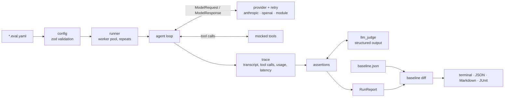

# agentcheck

[](https://github.com/prakhar083/agentcheck/actions/workflows/ci.yml)
[](LICENSE)

A test runner for LLM agents: describe conversations, mock the tools, assert on what the agent did, and gate CI on the result.

## Why

Unit tests stop at the prompt boundary. Once a model is choosing which tools to call, in what order, with what arguments, the behaviour you care about lives in the loop, and it changes every time you edit a system prompt, swap a model or add a tool.

agentcheck runs that loop for real against the model, but answers every tool call from fixtures you write in YAML. Runs are hermetic (no live databases, no refunds actually issued), so you can assert on the trajectory as well as the final text:

- did it call `lookup_order` before `issue_refund`, with the right `order_id`?
- did it stay under 4 turns and $0.01?
- does a judge model agree it followed the refund policy, and does it still pass 9 times out of 10?

Results come out as a terminal report, JSON, JUnit XML and a Markdown summary for pull requests. A previous JSON report can be used as a baseline, so a prompt change that turns a passing case red fails the build.

## What it looks like

```
$ agentcheck run "examples/**/*.eval.yaml" --verbose

customer-support examples/support-agent/support.eval.yaml · mock-support-agent
  ✓ order status for an in-transit order                1/1   2.0 turns    $0.0016        172ms
  ✓ refunds a damaged item inside the window            3/3   3.0 turns    $0.0091    p50 208ms  judge 5.0
  ✓ declines a refund outside the 30-day window         1/1   2.0 turns    $0.0018        170ms  judge 5.0
  ✓ escalates high-value damage instead of refunding    1/1   3.0 turns    $0.0031        232ms
  ✓ unknown order asks the customer to double-check     1/1   2.0 turns    $0.0016        200ms
  ✓ structured order summary                            1/1   2.0 turns    $0.0013        168ms
  ~ follow-up on refund status (flaky)                  3/4   1.0 turns    $0.0034     p50 73ms
      attempt 4:
      ✗ contains "R-5521" — output is missing "R-5521"
        output: Your refund has been approved and is on its way back to your card.

Summary
  cases     7 passed, 1 flaky (7 total)
  attempts  11/12 passed
  tokens    8,206 in · 556 out
  cost      $0.0220 agent · $0.0051 judge
  latency   p50 170ms · p95 232ms
  duration  592ms
```

Columns are passing attempts, mean turns, total cost across attempts, latency (p50 when a case repeats) and mean judge score.

## Quickstart

The repository ships an offline example: a customer-support agent with order-lookup, refund and escalation tools, driven by a scripted mock model. No API key needed.

```sh
git clone https://github.com/prakhar083/agentcheck.git
cd agentcheck
npm ci
npm run example
```

To use it in your own project:

```sh
npm install --save-dev github:prakhar083/agentcheck
export ANTHROPIC_API_KEY=...
npx agentcheck run                       # finds **/*.eval.yaml
```

A minimal suite:

```yaml
# evals/support.eval.yaml
name: support
provider:
  type: anthropic
  model: claude-sonnet-5-5

system: You are a support agent. Look orders up before answering.

tools:
  - name: lookup_order
    description: Fetch an order by ID.
    input_schema:
      type: object
      properties: { order_id: { type: string } }
      required: [order_id]
    responses:
      - when: { order_id: A1002 }
        response: { status: in_transit, eta: "2026-03-14" }
      - error: order not found

cases:
  - name: order status
    input: Where is my order A1002?
    assert:
      - type: tool_called
        name: lookup_order
        args: { order_id: A1002 }
      - type: contains
        value: in transit
        ignore_case: true
      - type: max_turns
        value: 3
```

## Suite reference

A suite is one YAML file. Everything except `cases` is optional.

| Key | Description |
| --- | --- |
| `name` | Suite name. Defaults to the file name without `.eval.yaml`. |
| `provider` | Model the agent runs on. See [Providers](#providers). Default: Anthropic, `claude-sonnet-5-5`. |
| `judge` | Overrides for the `llm_judge` model. Inherits `provider`, so `judge: { model: claude-opus-5-5 }` is enough. |
| `system` | System prompt for every case. |
| `tools` | Tool definitions and their mocked responses, shared by every case. |
| `defaults` | `max_turns` (default 10), `repeat` (default 1), `pass_threshold` (default 1.0) for every case. |
| `pricing` | Extra or overriding prices, in USD per million tokens: `{ model-id: { input, output, cache_read?, cache_write? } }`. |
| `cases` | The test cases. |

### Cases

| Key | Description |
| --- | --- |
| `name` | Unique within the suite. |
| `input` | A single user message. |
| `messages` | A prior conversation (`role: user` / `assistant`, `content`) ending in a user message. Use instead of `input`. |
| `system` | Replaces the suite system prompt. |
| `tools` | Added to the suite tools; a tool with the same name replaces the suite's version. |
| `assert` | List of assertions. Every one must pass for an attempt to pass. |
| `repeat` | Run the case N times. |
| `pass_threshold` | Fraction of attempts that must pass, from 0 to 1. Default 1 (all of them). |
| `max_turns` | Model calls allowed before the attempt is failed. |
| `tags`, `description` | Carried through to reports. |

An attempt also fails, regardless of assertions, if the agent hits `max_turns` without finishing, the model returns a refusal, or the provider keeps failing after retries.

### Mocked tools

Each tool has a `name`, `description` and JSON Schema `input_schema`, which are sent to the model as-is. Its result comes from one of:

```yaml
# The same response for any arguments.
response: { status: delivered }

# Rules tried in order; the first whose `when` is a subset of the call's arguments wins.
# A rule without `when` matches anything. `error` returns a tool error to the model.
responses:
  - when: { order_id: A1001 }
    response: { status: delivered, total: 89.0 }
  - when: { order_id: A1003, include_history: true }
    response: "plain strings are passed through unchanged"
  - error: order not found
```

Subset matching is structural: nested objects match on the keys you list, arrays must match element-wise, scalars must be equal. A call that matches no rule gets a tool error describing the arguments, which usually shows up as a failed assertion rather than a crash.

### Assertions

| Type | Fields | Passes when |
| --- | --- | --- |
| `contains` | `value` (string or list), `ignore_case` | The final answer contains every value. |
| `not_contains` | `value`, `ignore_case` | The final answer contains none of the values. |
| `regex` | `pattern`, `flags` | The final answer matches. |
| `equals` | `value` | The trimmed final answer equals `value`. |
| `json_schema` | `schema` | The final answer parses as JSON (bare or in a fenced block) and validates against the schema. |
| `tool_called` | `name`, `args`, `count`, `after` | At least one call to `name` whose arguments contain `args`. With `count`, exactly that many. With `after`, one of them comes after a call to that tool. |
| `tool_not_called` | `name`, `args` | No call to `name` (with matching `args`, if given). |
| `tool_sequence` | `names` | The calls contain `names` in order, other calls allowed in between. |
| `max_turns` | `value` | The agent used at most this many model calls. |
| `max_cost_usd` | `value` | The attempt's agent cost (judge excluded) is at most this. Fails if the model has no price. |
| `max_latency_ms` | `value` | Wall-clock time of the agent loop is at most this. |
| `llm_judge` | `rubric`, `threshold` (1-5, default 4) | A judge model scores the transcript against the rubric at or above the threshold. |

The judge sees the system prompt, the full transcript including tool calls and results, and the final answer. It returns `{ reasoning, score }` via structured output (`output_config.format` on Anthropic, `response_format: json_schema` on OpenAI-compatible APIs). The parser also accepts JSON wrapped in prose or a code fence, so servers without structured output still work. Scores and reasoning appear in every report.

### Providers

| `type` | Fields | Notes |
| --- | --- | --- |
| `anthropic` | `model`, `max_tokens`, `effort`, `api_key_env`, `base_url` | Official `@anthropic-ai/sdk`. Credentials resolve as the SDK does (`ANTHROPIC_API_KEY`, `ant auth login` profiles, ...). |
| `openai` | `model`, `base_url`, `api_key_env`, `max_tokens` | Official `openai` SDK, Chat Completions. `base_url` points it at any compatible server: vLLM, Ollama, LM Studio, OpenRouter, Together. |
| `module` | `module`, `model` | An ES module (path relative to the suite) whose default export is a provider or a function returning one. Use it to test your own agent stack, or for offline mocks like [`examples/support-agent/mock-agent.mjs`](examples/support-agent/mock-agent.mjs). |

A provider is one method:

```ts
interface Provider {
  name: string;
  complete(request: ModelRequest): Promise<ModelResponse>;
}
// request:  { model, system?, messages, tools, maxTokens, responseSchema? }
// response: { text, toolCalls: [{ id, name, args }], stopReason, usage }
```

## Repeats and flakiness

Agents are stochastic, so a single green run proves little. `repeat: N` runs a case N times (or `--repeat N` for every case). The case passes if its pass rate reaches `pass_threshold`, and it is flagged **flaky** when some attempts pass and some fail, whether or not it met the threshold. Reports show the pass rate, the mean judge score across attempts, and the first failing attempt in full (`--verbose` shows all of them).

## Cost and latency

Token usage is read from each response, including cache reads and writes, and priced from a single table in [`src/pricing.ts`](src/pricing.ts) holding first-party Anthropic list prices. Anything else, such as a fine-tune, an OpenAI model or a local server, can be priced per suite with `pricing:`. Unpriced models report `n/a` rather than a wrong number. Judge spend is tracked separately from agent spend.

Latency is measured around the whole agent loop for each attempt and reported as p50/p95 per case and per run.

## CLI

```
agentcheck run [patterns...]

  -c, --concurrency <n>   attempts to run in parallel (default: 4)
  -r, --repeat <n>        override every case's repeat count
  -f, --filter <pattern>  only run cases whose 'suite › case' name matches (regex or substring)
  --reporter <name>       stdout format: pretty | json | markdown | junit (default: pretty)
  --json <file>           write the JSON report (usable as a baseline)
  --markdown <file>       write a Markdown summary
  --junit <file>          write JUnit XML
  -b, --baseline <file>   compare against a previous JSON report; regressions fail the run
  --score-tolerance <n>   judge score drop that counts as a regression (default: 0.5)
  --retries <n>           retries per model call on 429/5xx/network errors (default: 4)
  -v, --verbose           show every failing attempt and log retries
  --no-color              disable ANSI colors
```

Exit codes: `0` everything passed, `1` a case failed or a baseline regression was found, `2` bad configuration or usage.

Model calls that fail with 408, 409, 429, 5xx or a connection error are retried with exponential backoff and jitter, honouring `Retry-After`. The SDKs' own retries are switched off so there is exactly one policy.

## Baselines

```sh
agentcheck run --json evals/baseline.json            # record
agentcheck run --baseline evals/baseline.json        # compare
```

A regression is a case that went from pass to fail, or whose mean judge score dropped by at least `--score-tolerance`. Improvements, new cases and removed cases are listed but don't fail the run. Committing the baseline next to the suites works well: re-recording it is a deliberate, reviewable change, like updating a snapshot.

## CI

The repository is also a composite GitHub Action. It runs the suites, writes `results.json`, `summary.md` and `junit.xml`, appends the summary to the job's step summary, and fails the step on failures or regressions.

```yaml
# .github/workflows/evals.yml
name: evals
on: pull_request

jobs:
  agentcheck:
    runs-on: ubuntu-latest
    permissions:
      contents: read
      pull-requests: write
    steps:
      - uses: actions/checkout@v5

      - uses: prakhar083/agentcheck@main
        id: evals
        with:
          suites: evals/**/*.eval.yaml
          baseline: evals/baseline.json
          args: --concurrency 8
        env:
          ANTHROPIC_API_KEY: ${{ secrets.ANTHROPIC_API_KEY }}

      - name: Comment on the PR
        if: always() && steps.evals.outputs.exit-code != '2'
        run: gh pr comment ${{ github.event.pull_request.number }} --body-file agentcheck-results/summary.md --edit-last --create-if-none
        env:
          GH_TOKEN: ${{ github.token }}
```

| Input | Default | |
| --- | --- | --- |
| `suites` | `**/*.eval.{yaml,yml}` | Space-separated files or globs. |
| `baseline` | | JSON report to compare against. A missing file is a warning, so the first run can create it. |
| `args` | | Extra flags for `agentcheck run`. |
| `working-directory` | `.` | |
| `results-dir` | `agentcheck-results` | |
| `node-version` | `22` | |

Outputs: `exit-code` and `results` (path to the JSON report). Outside GitHub, `--markdown` and `--junit` plug into any CI that renders Markdown or JUnit.

## Programmatic use

```ts
import { loadSuiteFile, renderMarkdown, runSuites } from "agentcheck";

const suite = await loadSuiteFile("evals/support.eval.yaml");
const report = await runSuites([suite], { concurrency: 8 });
console.log(renderMarkdown(report));
```

`MockProvider` (scripted steps or a handler function) and `runAgentLoop` are exported for testing agents in your own test framework.

## Architecture



- **Provider-neutral core.** Everything between the loader and the reporters works on one small message model (`src/types.ts`). Providers translate at the edge; the Anthropic provider keeps each assistant turn's original content blocks and replays them verbatim, so thinking blocks survive multi-turn tool use.
- **Hermetic tools.** The agent loop never executes anything. Tool calls are resolved against fixtures, which makes a run reproducible up to model sampling and means a refund case can't refund anyone.
- **Attempts are the unit of work.** Each `(case, repeat)` pair is an independent task in a bounded worker pool; cases are aggregated afterwards, which is what makes pass rates, flakiness and percentiles straightforward.
- **Reports are data.** The JSON report is the source of truth. The other reporters and the baseline diff are pure functions of it.
- **Refusals are results.** If the model declines (`stop_reason: refusal`), the attempt fails and says so. agentcheck does not silently retry on a different model, because that would evaluate a model you didn't ask about.

```
src/
  config/       schema (zod), loader, normalized types
  providers/    anthropic, openai, module loader, mock, retry policy
  runner/       agent loop, tool mocks, worker pool, aggregation
  assertions/   every assertion type
  judge.ts      prompt, structured-output schema, tolerant parser
  baseline.ts   regression diffing
  pricing.ts    the price table
  reporters/    terminal, json, markdown, junit
```

## Development

```sh
npm ci
npm test            # vitest, no network: every test uses the mock provider
npm run typecheck
npm run lint
npm run build
```

## Roadmap

- Simulated users: a second model plays the customer for multi-turn cases.
- Tool fixtures from recordings: capture real tool traffic once, replay it in suites.
- Streaming providers and per-turn time-to-first-token.
- Statistical comparison of pass rates against the baseline (confidence intervals instead of pass/fail flips).
- More native providers (Bedrock, Vertex AI, Gemini) beyond the OpenAI-compatible path.
- A static HTML report with transcript diffs between runs.

## License

[MIT](LICENSE) © 2026 Prakhar Vijay
